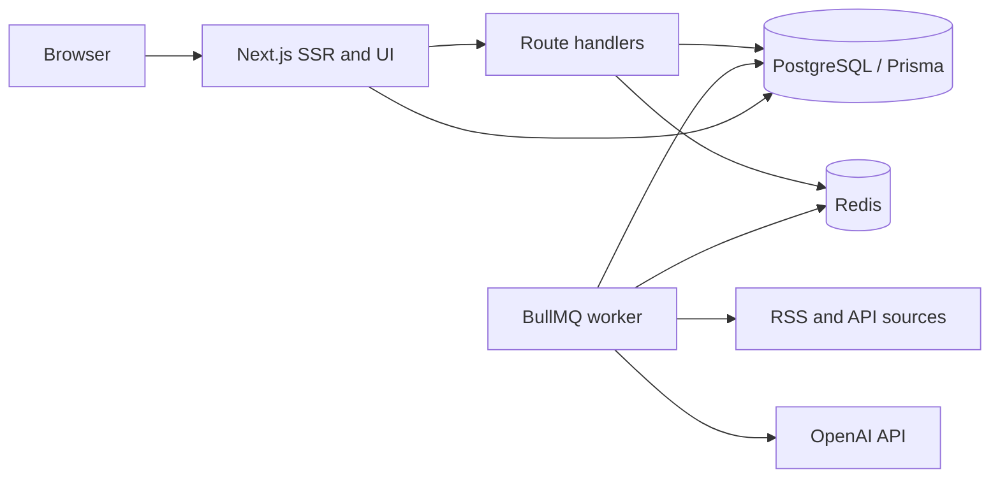

# IT Digest

IT Digest is a Next.js technology news digest for World and Vietnam. The app uses database-backed story feeds, localized pages, Prisma/PostgreSQL, BullMQ ingestion and processing workers, and local Postgres/Redis services.

## Local development

1. Install Node.js 20.6+ and Docker Compose.
2. Copy `.env.example` to `.env`. Set `OPENAI_API_KEY` for AI summaries/briefings and `RESEND_API_KEY` plus a verified `RESEND_FROM_EMAIL` for newsletter delivery. Set `NEXT_PUBLIC_APP_URL` to the public site origin for sitemap URLs. Set `ADMIN_USERNAME`, `ADMIN_PASSWORD` and a unique random `ADMIN_SESSION_SECRET` to enable the CMS menu; the secret must remain private. Prisma CLI reads `.env` (not `.env.local`); Next.js also loads `.env`. The worker uses extractive summaries when no OpenAI key is configured.
3. Start dependencies: `docker compose up -d`.
4. Install and prepare: `npm install && npx prisma generate && npx prisma migrate dev --name init`.
5. Run the app with `npm run dev` and the background worker in a second terminal with `npm run worker`. Use `npm start` for the production web server; run `npm run worker` as a separate, continuously running process.

The homepage, localized search and story detail pages read from PostgreSQL. BullMQ workers run as a dedicated process, separate from the Next.js web server. RSS polling interval and pause/resume controls are available in CMS at `/admin`; the CMS can enqueue an immediate fetch. A new database starts with an empty feed until the first RSS jobs complete. The stories API returns a 503 when the database is unavailable rather than presenting demo content.

## Languages

Vietnamese is the default: `/` redirects to `/vi`. English, Japanese and Korean are available at `/en`, `/ja` and `/ko`. The language menu in the header lets readers switch languages. Navigation, filters, search, trend page and metadata are localized in `src/lib/i18n.ts`. RSS story content remains in the publisher's original language. Search and trend pages are available at `/{locale}/search` and `/{locale}/trends`. Legacy `/search` and `/trends` routes redirect to Vietnamese.

The `Article.language` field is detected during RSS ingestion for Vietnamese, English, Japanese and Korean. Article titles and summaries remain in the publisher's original language; the generated daily briefing is stored in all four locales when OpenAI is configured.

## Source links

Story titles open the internal detail page. Publisher names and the “Read at source” action open the exact canonical RSS URL stored in `Article.url` in a new tab.

Each story has a detail page at `/{locale}/story/{slug}` (the unprefixed `/story/{slug}` redirects to Vietnamese) with its AI summary, highlights, source links and article timeline. Readers can save stories locally in their browser and review them at `/{locale}/bookmarks`.

The weekly newsletter form requires explicit consent, stores subscribers in PostgreSQL and sends a welcome email through Resend. Configure a verified sender before accepting signups. The source health dashboard at `/{locale}/analytics` reports feed status, last fetch, article counts and latest article dates. The CMS menu opens `/admin`; sign in with the configured admin username and password to add, edit, pause, resume or remove RSS sources. Changes are stored in PostgreSQL and the worker reads enabled sources on its next scheduled run. Dark mode is controlled from the header and saved in browser storage. `/sitemap.xml` is a sitemap index with paginated localized landing/trends and story URLs; `/robots.txt` points crawlers to it.

## Architecture



The application layer is the Next.js app router and route handlers; `src/lib` contains persistence, queue, feed registry and news domain helpers; `src/worker.ts` defines BullMQ jobs and `src/worker-entry.ts` runs them in a dedicated process. Keep feed polling and model calls out of request handlers. PostgreSQL stores canonical articles, grouped stories, user preferences, source registry, worker polling settings, digests and processing state. Redis/BullMQ provides retryable asynchronous work.

## Data model

Prisma models live in `prisma/schema.prisma`. `Article` has a unique canonical URL and belongs to at most one `Story`; a story groups source articles and carries its digest summary and ranking. `UserPreference` supports category personalization. `Digest` persists daily/weekly snapshots. `Source` supports managed feed configuration. `WorkerSetting` stores the ingestion schedule and pause state. `ProcessingJob` records operational status. Indexes support region/category/time/rank queries and normalized-title matching.

Article grouping starts with region, a seven-day window and normalized title token overlap. For higher precision at scale, add PostgreSQL full-text/trigram or vector similarity and have the AI layer confirm candidate matches before linking. The MVP grouping heuristic should be monitored for false positives.

## API design

| Method | Route | Purpose |
|---|---|---|
| GET | `/api/health` | Liveness check |
| GET | `/api/stories?q=&region=&category=&from=&to=&ids=&limit=` | Ranked, filterable story search; limit 1–100 |
| POST | `/api/newsletter` | Validate consent, subscribe, and send welcome email with Resend |
| GET | `/{locale}/search?q=` | Localized, database-backed search (`vi`, `en`, `ja`, `ko`) |
| GET | `/{locale}/story/{slug}` | Story summary, highlights, source list and timeline |
| GET | `/{locale}/trends` | Localized weekly trend overview |
| GET | `/{locale}/analytics` | Source freshness and RSS ingest health dashboard |
| GET | `/sitemap.xml` | Localized public pages and story URLs |

Preference routes and digest retrieval still need authentication. Admin source management is available at `/admin` and its APIs require the signed admin session cookie. API validation uses Zod; list responses are cacheable briefly. Database full text should use a generated `tsvector` and GIN index (or a dedicated search service) as article volume grows.

## RSS ingestion and AI processing

`src/lib/feeds.ts` contains the requested initial source list. Every 30 minutes the worker fetches feeds, deduplicates by URL, stores article metadata and queues processing. The processing worker classifies by keyword, summarizes with OpenAI JSON output when configured, estimates relevance, scores recency/source activity, and attaches likely duplicates to a story. Daily and weekly jobs persist digest snapshots. Queue retries and dead-letter monitoring should be configured in the production Redis deployment.

Feed URLs and availability vary; validate each source before operating production ingestion. Respect publisher terms, robots policies and rate limits. Store metadata and short excerpts unless you have rights to retain full text. Avoid treating model output as trusted HTML.

## MVP delivery plan

1. **Foundation (included):** responsive localized SSR UI, database-backed feed and search, story detail pages, browser bookmarks, AI digest jobs, newsletter signup, language detection, sitemap, dark mode, source health dashboard, core schema, API, containers and RSS workers.
2. **Ingestion hardening:** verify feed URLs and publisher policies, add deeper feed health alerts, tune retry/backoff, and improve article extraction limits.
3. **AI quality:** add prompt/model versioning, summary regeneration, human review and story merge/split controls.
4. **Product:** Auth.js Google/GitHub, account-backed bookmarks, preference management, personalized ranking, category pages and subscription preferences.
5. **Production readiness:** migrations in CI/CD, backups, observability, load tests, security review and staged deployment.

## Production deployment

Deploy the Next.js app and worker as separate stateless processes. Use managed PostgreSQL and Redis with TLS, private networking, connection pooling (for example PgBouncer), automated backups and restore drills. Set environment variables through the deployment secret manager. Run `prisma migrate deploy` once as a release step, then deploy web and worker. Add health probes, structured logs, queue depth and feed failure alerts, OpenAI spend limits, request rate limits and CDN caching. Configure a public domain, HTTPS, canonical metadata, OpenGraph image, `robots.txt` and sitemap before launch. No credentials belong in source control.

## CI/CD and test strategy

CI should run install with lockfile, Prisma client generation, lint, TypeScript checking, unit tests for classifier/scoring/grouping, API integration tests against disposable PostgreSQL/Redis, and a production build. Deploy only after migrations and smoke checks; use a staging environment and rollback-capable releases. Add contract tests for RSS parsers, duplicate URL idempotence, queue retries, summary schema validation, search filters, digest boundaries and preference ranking. Monitor p95 API latency (<500 ms target), homepage LCP (<2 s target), error rates, queue lag and source freshness. Use synthetic data near 100k articles when validating query plans.

## Folder structure

```text
src/app/           App Router pages, localized routes, SEO metadata, and route handlers
src/components/    UI components
src/lib/           News types, translations, language detection, Prisma client, RSS feeds, queue wiring
src/worker.ts      Background job processors and schedules
prisma/            PostgreSQL Prisma schema
docker-compose.yml Local PostgreSQL and Redis
```

## Known MVP boundaries

Bookmarks are browser-local until authentication is added. Newsletter delivery requires Resend credentials and a verified sender. AI summaries and daily briefings fall back to extractive text if no OpenAI key is configured. Automatic language detection is heuristic and should be monitored for misclassification. Verify source URLs and publisher policies before enabling production ingestion.
